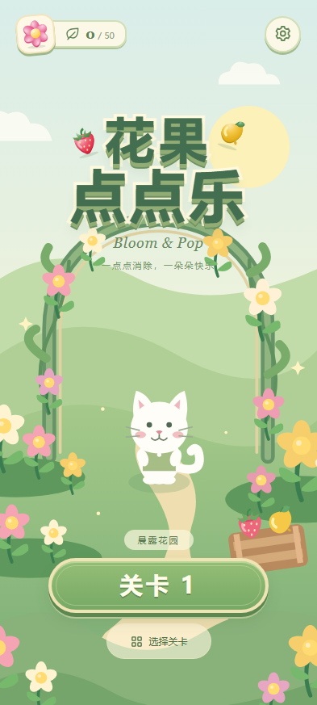
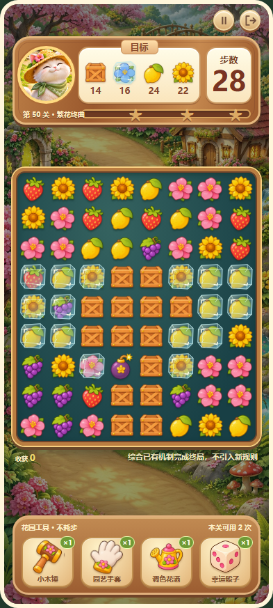
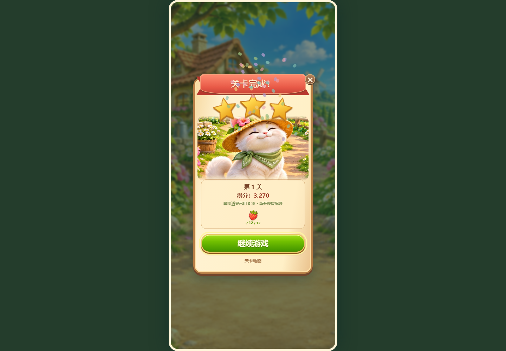

# 花果消消乐开发者文档
GDD / Technical Design Document V1.0-Web Demo

项目名称：花果消消乐 · Bloom & Pop
项目类型：2D 花朵水果主题休闲点击消除
交付形式：原生 HTML / CSS / JavaScript，单文件离线网页
目标设备：Android 手机竖屏浏览器；电脑显示居中竖屏画布
关卡规模：50 关，5 个章节，每章 10 关
页面范围：首页、游戏页、成功/失败结果页
文档版本：V1.0-Web Demo
版本日期：2026-11-22

执行目标：从零建立完整工程，按本文创建页面、素材、规则、数据、动画和测试，产出双击即玩的 index.html。本文中的关卡表、算法顺序、界面规格和验收用例共同构成执行依据。

## 阅读导航
1. 项目概述
2. 核心玩法规则
3. 特殊棋子系统
4. 目标系统
5. 障碍与棋盘结构
6. 数值系统
7. 随机与死局处理
8. 50 关内容设计
9. 关卡配置与初始布局
10. UI、视觉与交互
11. 辅助操作与表现系统
12. 本地进度保存
13. 技术架构与接口
14. 项目目录与构建
15. 开发阶段与分段验收
16. 最终验收标准
17. Codex 执行指令

## 界面基准






# 1. 项目概述
## 1.1 产品定位
玩家单指点击横竖相邻的同色花果，消除群组并制造特殊棋子，在有限步数内完成全部收集目标。每次消除后，存活棋子按列下落，区段顶部补充新花果。游戏采用柔和薄荷绿、奶油黄与粉色的原创矢量花园画风，首页场景由花拱门、小兔、花丛、果箱、草地和小径组成。
核心体验由「寻找连通群组 → 点击收获 → 生成/触发道具 → 缓速掉落 → 检查目标」循环构成。规则即时计算，表现分阶段播放，棋盘在动画结束后恢复输入。

## 1.2 交付清单与范围
| 层级 | 交付内容 |
| --- | --- |
| 页面 | 全屏花园首页、竖屏游戏页、成功结果页、失败结果页 |
| 弹窗 | 五章选关、设置、玩法说明、重开确认 |
| 棋盘 | 固定 8 列×9 行，普通花果、火箭、炸弹、彩虹花、木箱、冰层、缺口 |
| 关卡 | 50 份独立 JSON，固定种子、步数、色数、目标及形状 |
| 操作 | 点击、键盘操作、免费提示、重开、选关、返回首页 |
| 表现 | 消除、道具蓄力与释放、连锁错峰、真实掉落、回弹、粒子、合成音效 |
| 存储 | 每关最高星级、音效开关，保存在 localStorage |
| 工程 | 分层源码、SVG 素材、标准库构建脚本、离线 index.html、设计与测试文档 |
交付范围止于以上清单。体力、货币、商城、账号、服务器、广告、养成、社交、每日活动、关卡锁定、手动锤子、手动洗牌、石头、锁链、掉落收集物和音乐系统均不进入本版本。

## 1.3 实现优先级
P0：确定性规则、50 关数据、单局胜负、离线构建、三类页面。
P1：全部特殊棋子与组合、障碍、死局重排、竖屏适配、本地进度、输入锁与取消。
P2：首页场景、道具表现、真实掉落、音效、粒子、键盘和减少动态效果路径。
P0、P1、P2 均属于最终交付内容，按第 15 章顺序实现和验收。

# 2. 核心玩法规则
## 2.1 棋盘与棋子
| 参数 | 固定值 |
| --- | --- |
| 棋盘 | 8 列×9 行，共 72 个逻辑位置 |
| 坐标 | r=0…8，c=0…7；索引 i=r×8+c |
| 普通颜色 | 4、5 或 6 种，取颜色枚举前 colors 项 |
| 连通方向 | 上、下、左、右，严格按此顺序枚举 |
| 最小消除 | 2 个同色普通棋子 |
| 步数消耗 | 每次有效点击 1 步；连锁不另扣步 |
| 补齐方式 | 按列、按缺口/木箱分段，顶部补齐 |
| 自动三消 | 补齐后保持棋盘，不自动消除新形成的群组 |

| color | 名称 | 素材文件 |
| --- | --- | --- |
| 0 | 草莓 | strawberry.svg |
| 1 | 柠檬 | lemon.svg |
| 2 | 葡萄 | grapes.svg |
| 3 | 粉色小花 | flower_pink.svg |
| 4 | 向日葵 | sunflower.svg |
| 5 | 蓝色小花 | flower_blue.svg |
棋盘使用长度为 72 的数组，缺口为 null。普通棋子 kind=normal；特殊棋子 kind=rocket/bomb/rainbow；木箱 kind=box。每次创建棋子分配递增 id，存活棋子移动保持 id。冰层为棋子上的 ice:true。

## 2.2 连通块判定
从被点击普通棋子开始执行 BFS，按上、下、左、右检查邻居；仅将 kind=normal 且 color 相同的棋子入队。带冰普通棋子参加同色连通，特殊棋子与木箱不参加普通连通。斜向相邻无效，左右邻居不得跨行。
群组少于 2 时返回 valid:false、reason:single；步数、分数、棋盘和收集数不变。点击缺口、木箱、越界位置或已结束关卡时返回 valid:false。

## 2.3 一次有效操作的逻辑顺序
1. 保存点击前棋盘快照及棋子 id、DOM 位置，作为动画输入。
2. 普通棋子计算群组；特殊棋子查找上下左右第一个相邻特殊棋子，确定单体或组合目标。
3. 普通群组达到阈值且点击棋子未带冰时，确定待生成道具；方向随机只在生成火箭时取样。
4. 按第 3.5 节命中队列处理冰层、特殊触发、花果收集、木箱标记和移除列表。
5. 统一移除普通/特殊棋子与已标记木箱；待生成道具在点击位置创建，分配新 id。
6. moves 减 1，turns 加 1，按第 6 章累计分数。
7. 执行分段重力与新棋子补齐。新道具参与本次重力。
8. 全部目标完成则 status=won；否则 moves≤0 则 status=lost；其余 status=playing。
9. 仅在 playing 时检查并修复死局。返回完整回合结果，再按第 11 章播放动画。
10. 动画完成后开放棋盘输入；终局额外等待 500ms 后进入结果页。

## 2.4 重力与补齐
从左到右处理每列，按从上到下顺序识别连续有效区段。缺口和仍存在的木箱均结束区段。区段按原有上下顺序收集存活棋子，再从最底格向上逐个放回，保持相对顺序。余下顶部空位从下向上调用 tile() 生成普通花果。
新棋子从所属区段顶部进入，不跨越仍存在的木箱或缺口。木箱被移除后位置恢复为有效格，原阻隔上下区段合并。冰层随绑定棋子移动。
构造和补齐调用同一随机流；列顺序、区段顺序、底部优先补齐顺序固定，保持固定种子结果一致。

# 3. 特殊棋子系统
## 3.1 生成阈值与位置
| 普通连通群组大小 | 生成结果 |
| --- | --- |
| 2–4 | 仅消除 |
| 5–6 | 火箭 |
| 7–8 | 花瓣炸弹 |
| ≥9 | 彩虹花 |
每次普通点击最多生成一个道具，保留群组颜色作为 color。生成位置为被点击格，随后受重力影响。点击棋子带冰时只执行命中处理，本次不生成道具；群组中其他位置带冰不阻止未带冰点击位置生成道具。
群组中被实际移除的棋子先计入收集与分数，再在点击位置创建道具。生成道具不增加 fired 次数。

## 3.2 单体效果
火箭：生成时取随机数，小于 0.5 记 axis=h，否则 axis=v。命中所在整行或整列。木箱和缺口不截断射线，缺口无对象并在处理时跳过。
花瓣炸弹：以自身为中心，命中行差≤1 且列差≤1 的格，形成 3×3 范围，棋盘边界以外裁去。
彩虹花（2026-11-23 更新）：主动操作使用 click(i,target)，先选中发光，再指定上下左右相邻棋子交换，以其颜色消除全盘同类并消除自身。非相邻输入取消，不扣步；冰冻棋子需先融化。被其他道具连锁命中时仍选棋盘数量最多颜色，平局取最小 color。
特殊棋子可单独点击，也可被命中队列触发。清除特殊棋子时按其 color 计入颜色目标，并增加 1 次 fired。

## 3.3 相邻组合
点击特殊棋子后按上、下、左、右查找第一个相邻特殊棋子作为伙伴。组合中心为玩家点击格。组合只消耗一次玩家步数。
| 组合 | 初始命中目标 |
| --- | --- |
| 火箭＋火箭 | 点击格整行与整列，再加入伙伴 |
| 火箭＋炸弹 | 点击格所在三行与三列，再加入伙伴 |
| 炸弹＋炸弹 | 点击格为中心 5×5，再加入伙伴 |
| 彩虹＋彩虹 | 全部 72 个位置 |
| 彩虹＋火箭 | 取非彩虹道具 color；命中双方与该色全部棋子；以每个该色位置为中心追加整行与整列 |
| 彩虹＋炸弹 | 取非彩虹道具 color；命中双方与该色全部棋子；以每个该色位置为中心追加 3×3 |
组合目标入队后，命中任何未处理特殊棋子时仍追加该棋子自身单体 effect()。最终范围是组合初始范围与各次单体连锁范围的并集。
例：两个上下相邻的横向火箭，初始命中点击格十字，伙伴火箭还追加自身所在行；按最终去重范围结算，不把组合简化为固定格数。

## 3.4 边界与重复命中
效果列表按行优先索引递增生成；合并目标保留入队顺序。同一格同回合只处理一次，冰层融化后该回合不再清除其花果。多个效果命中同一木箱只清除和统计一次。

## 3.5 命中队列算法
建立 queue、seen、removed、melted、boxes、fired。seen 和 boxes 使用 Set，其余为数组。顺序消费 queue，允许继续追加，直至遍历完毕；逻辑连锁不设 10 次截断。
1. 已在 seen 中或当前为 null 的格跳过；其余加入 seen。
2. kind=box：加入 boxes，继续下一索引。
3. 带 ice：删除 ice；collected.ice 加 1；加入 melted；继续下一索引。花果不清除，邻箱不受伤。
4. 特殊棋子：加入 fired，并把自身单体 effect() 索引追加到 queue。
5. collected['color'+color] 加 1；把当前格加入 removed；把上下左右木箱加入 boxes。
6. 队列结束后清空 removed；再清空 boxes，把箱格追加到 removed 并累计 collected.box。
7. 创建新道具，更新步数、计分、重力和胜负。
视觉层最多展示前 10 个 fired 的释放表现；该上限不限制逻辑队列。

# 4. 目标系统
## 4.1 三类目标
| kind | 字段 | 计数时点 |
| --- | --- | --- |
| color | color:0…5，target:正整数 | 带 color 棋子实际移除时，包含普通与特殊棋子 |
| box | target:正整数 | 木箱统一移除时 |
| ice | target:正整数 | 首次命中融冰时 |
分数仅展示，不作为通关目标。生成道具数、道具触发次数和掉落到底部均不构成本版本目标。

## 4.2 目标进度与显示
原始计数存于 collected，颜色键为 color0…color5，其他为 box、ice。progress(goal)=min(goal.target,collected[key]或0)。原始 collected 保留超额值，UI 截断至目标上限。
游戏页显示图标与剩余 target-progress，达成后显示「完成」及完成标识；结果页显示 progress/target。一关包含 1 或 2 个颜色目标，并按配置追加木箱和冰层，总目标数为 1–4。全部目标同时完成才判胜。

## 4.3 计数例子
两相邻同色棋子中一个带冰：扣 1 步，无冰棋子移除、颜色加 1；冰格只融冰、冰加 1，原棋子保留并参与重力。
爆炸移除草莓 3 个、草莓色火箭 1 个、木箱 2 个：草莓加 4，箱加 2，fired 按实际特殊触发计数。

# 5. 障碍与棋盘结构
## 5.1 木箱
木箱占一格，kind=box，只含 id，不含 color。不参加连通，不接受直接点击，不下落，阻断同列重力区段。
被特殊效果直接命中，或上下左右任意棋子实际移除时清除。每回合对同箱去重；移除贡献 60 分与 1 个 box 收集，位置恢复可补齐格。

## 5.2 冰层
冰层为普通棋子上的单层 ice:true。带冰棋子可点击、可连通、可下落。命中先融冰并保留棋子，不计颜色、不计移除分、不波及邻箱。
冰层不受其他格单纯邻消影响；只有该冰格进入普通群组或特殊效果目标时融化。点击冰格不生成道具。

## 5.3 缺口形状
| shape | 缺口坐标规则（0 起算） |
| --- | --- |
| 0 | 无缺口 |
| 1 | r∈{0,8} 且 c∈{0,7}，4 格 |
| 2 | r∈{0,8} 且 c∈{0,1,6,7}，8 格 |
| 3 | r∈{3,4} 且 c∈{0,7}，4 格 |
| 4 | r=0 且 c∈{0,1,6,7}，或 r=8 且 c∈{3,4}，6 格 |
缺口保留逻辑索引和不可点击 DOM 占位，坐标与列数不变。不生成棋子、不连通、不计分，分隔重力区段。

## 5.4 交互优先级
先木箱，再冰层，再特殊触发，再移除并收集颜色，再标记邻箱。所有范围处理结束后统一重力；补齐后计算胜负。

# 6. 数值系统
## 6.1 计分公式
```text
turnScore = removed.length × 60
          + fired.length × 150
          + (存在相邻组合 ? 300 : 0)
score += turnScore
```
removed 包含实际移除的普通、特殊棋子与木箱。melted 不计移除。生成道具不撤销原点击棋子的已收集数量和 60 分。组合每回合最多加 300，连锁特殊分别按 fired 计数。
普通清 3 个得 180；清 5 个生成火箭得 300；单火箭清 8 个对象且无连锁得 630；组合清 12 个对象、触发 2 个特殊得 1320。

## 6.2 步数与胜负
初始 moves 来自第 8 章，范围 22–50；turns 初始为 0。有效点击 moves 减 1、turns 加 1。无效点击、提示、重排不扣步。重开按同配置、同种子重建整局。
顺序固定：全部目标完成 → won；否则 moves≤0 → lost；否则 playing。最后一步达成计胜。终局不再接受消除输入。

## 6.3 星级与结算
| 状态 | 星级 |
| --- | --- |
| 胜利且剩余/初始步数≥0.35 | 3 星 |
| 胜利且比值≥0.15 且<0.35 | 2 星 |
| 其余胜利 | 1 星 |
| 失败 | 0 星 |
直接比较比值，不先四舍五入步数。初始 23 步时，剩余≥9 步三星，4–8 步二星，0–3 步一星。
结算不将剩余步数换分，不追加触发棋盘剩余道具，不追加奖励流程。

# 7. 随机与死局处理
## 7.1 固定随机流
使用以下 Mulberry32。开局、障碍洗牌、花果补齐、火箭方向、死局洗牌共用同一 rng，不另建阶段随机流。
```javascript
function random(seed) {
  let n = seed >>> 0;
  return () => {
    n += 0x6D2B79F5;
    let t = n;
    t = Math.imul(t ^ (t >>> 15), t | 1);
    t ^= t + Math.imul(t ^ (t >>> 7), t | 61);
    return ((t ^ (t >>> 14)) >>> 0) / 4294967296;
  };
}
```
普通颜色=floor(rng()×colors)，各色等概率，无目标颜色补偿。Fisher–Yates：i 从 length-1 降到 1，j=floor(rng()×(i+1))，交换 a[i]、a[j]。

## 7.2 合法操作
存在任一特殊棋子即有操作；否则存在横竖同色普通邻接对即有操作，冰层不排除此对。开局初始化后、以及每个有效回合补齐且仍 playing 时检查。

## 7.3 免费自动重排
索引递增收集所有普通棋子位置，把对应完整棋子对象洗牌回填；id 与 ice 跟随对象，特殊、木箱、缺口位置不变。
最多洗牌 20 次，每次检查，有操作立即停止。仍无操作时按普通索引顺序找第一对相邻普通棋子，将邻居色设为当前色，建立合法对。每次重排流程 shuffles 加 1；moves、turns、score、目标不变。
反馈：「没有可消除的组合，已自动重排，不消耗步数」。

# 8. 50 关内容设计
每关固定 rows=9、cols=8。目标列直接生成 goals；箱/冰列既是初始数量，也是对应目标数量。所有章节均使用全部特殊生成规则，不按章节禁用道具。形状按第 5.3 节，全部参数逐项写入独立 JSON。

## 8.1 晨露花园（1–10 关）
从一朵小花开始。4 色建立连通与道具生成，第 6 关起出现 5 色；部分关卡使用边角缺口。
章节提示：相邻的同色花果，两个就能消除。

| 关 | 步 | 色 | 箱 | 冰 | 形 | 种子 | 目标 |
| --- | --- | --- | --- | --- | --- | --- | --- |
| 01 | 23 | 4 | 0 | 0 | 0 | 1041 | 草莓×18 |
| 02 | 23 | 4 | 0 | 0 | 0 | 2087 | 柠檬×20；葡萄×12 |
| 03 | 22 | 4 | 0 | 0 | 0 | 3061 | 葡萄×22；粉花×16 |
| 04 | 24 | 4 | 0 | 0 | 1 | 4093 | 粉花×26；草莓×18 |
| 05 | 23 | 4 | 0 | 0 | 0 | 5059 | 草莓×28；柠檬×20 |
| 06 | 26 | 5 | 0 | 0 | 0 | 13992 | 草莓×24；葡萄×18 |
| 07 | 27 | 5 | 0 | 0 | 1 | 7079 | 柠檬×26；粉花×20 |
| 08 | 26 | 5 | 0 | 0 | 0 | 8081 | 葡萄×28；向日葵×22 |
| 09 | 27 | 5 | 0 | 0 | 2 | 9091 | 粉花×30；草莓×24 |
| 10 | 28 | 5 | 0 | 0 | 1 | 10099 | 向日葵×34；柠檬×26 |

## 8.2 蜜桃果园（11–20 关）
打开丰收的礼物。引入木箱和邻消，数量从 4 增至 14，配合颜色收集。
章节提示：在木箱旁消除花果，或用特殊道具击碎木箱。

| 关 | 步 | 色 | 箱 | 冰 | 形 | 种子 | 目标 |
| --- | --- | --- | --- | --- | --- | --- | --- |
| 11 | 28 | 4 | 4 | 0 | 0 | 11113 | 葡萄×26；箱×4 |
| 12 | 29 | 4 | 6 | 0 | 0 | 12203 | 粉花×28；葡萄×16；箱×6 |
| 13 | 29 | 5 | 6 | 0 | 1 | 13217 | 葡萄×30；草莓×18；箱×6 |
| 14 | 30 | 5 | 8 | 0 | 0 | 14221 | 粉花×30；柠檬×20；箱×8 |
| 15 | 30 | 5 | 8 | 0 | 2 | 15227 | 向日葵×32；葡萄×22；箱×8 |
| 16 | 31 | 5 | 10 | 0 | 0 | 24150 | 草莓×32；向日葵×24；箱×10 |
| 17 | 31 | 5 | 10 | 0 | 1 | 33077 | 柠檬×34；草莓×22；箱×10 |
| 18 | 32 | 5 | 12 | 0 | 0 | 18253 | 葡萄×34；柠檬×24；箱×12 |
| 19 | 32 | 5 | 12 | 0 | 2 | 19259 | 粉花×36；葡萄×26；箱×12 |
| 20 | 34 | 5 | 14 | 0 | 1 | 51937 | 向日葵×38；粉花×28；箱×14 |

## 8.3 薄荷溪谷（21–30 关）
融化清晨的冰晶。引入冰层，后半章混入木箱。
章节提示：冰层需要一次命中才能融化，里面的花果会保留。

| 关 | 步 | 色 | 箱 | 冰 | 形 | 种子 | 目标 |
| --- | --- | --- | --- | --- | --- | --- | --- |
| 21 | 31 | 4 | 0 | 8 | 0 | 21269 | 草莓×28；冰×8 |
| 22 | 32 | 4 | 0 | 10 | 1 | 22271 | 柠檬×30；葡萄×18；冰×10 |
| 23 | 32 | 5 | 0 | 10 | 0 | 31198 | 葡萄×30；粉花×20；冰×10 |
| 24 | 33 | 5 | 0 | 12 | 2 | 103471 | 粉花×32；向日葵×22；冰×12 |
| 25 | 34 | 5 | 0 | 14 | 0 | 49046 | 向日葵×32；草莓×24；冰×14 |
| 26 | 35 | 5 | 4 | 12 | 1 | 42141 | 草莓×34；柠檬×24；箱×4；冰×12 |
| 27 | 35 | 5 | 4 | 14 | 0 | 58983 | 柠檬×34；葡萄×26；箱×4；冰×14 |
| 28 | 36 | 5 | 6 | 14 | 2 | 67904 | 葡萄×36；粉花×26；箱×6；冰×14 |
| 29 | 37 | 5 | 6 | 16 | 1 | 53068 | 粉花×36；向日葵×28；箱×6；冰×16 |
| 30 | 38 | 5 | 8 | 16 | 0 | 85746 | 向日葵×40；草莓×30；箱×8；冰×16 |

## 8.4 莓果秘境（31–40 关）
绕过弯弯的小路。多形状缺口，组合箱、冰和双颜色目标。
章节提示：棋盘缺口不会填充，留意每一列的掉落方向。

| 关 | 步 | 色 | 箱 | 冰 | 形 | 种子 | 目标 |
| --- | --- | --- | --- | --- | --- | --- | --- |
| 31 | 34 | 5 | 4 | 8 | 3 | 39238 | 草莓×32；葡萄×22；箱×4；冰×8 |
| 32 | 35 | 5 | 6 | 8 | 4 | 48159 | 柠檬×34；粉花×24；箱×6；冰×8 |
| 33 | 36 | 5 | 6 | 10 | 3 | 57086 | 葡萄×34；向日葵×26；箱×6；冰×10 |
| 34 | 37 | 5 | 8 | 10 | 4 | 34337 | 粉花×36；草莓×26；箱×8；冰×10 |
| 35 | 38 | 5 | 8 | 12 | 2 | 35339 | 向日葵×36；柠檬×28；箱×8；冰×12 |
| 36 | 38 | 5 | 8 | 12 | 3 | 44260 | 草莓×38；粉花×28；箱×8；冰×12 |
| 37 | 39 | 5 | 10 | 12 | 4 | 37343 | 柠檬×38；向日葵×30；箱×10；冰×12 |
| 38 | 39 | 5 | 10 | 14 | 3 | 77946 | 葡萄×40；草莓×30；箱×10；冰×14 |
| 39 | 40 | 5 | 10 | 14 | 4 | 55197 | 粉花×42；柠檬×32；箱×10；冰×14 |
| 40 | 41 | 5 | 12 | 14 | 2 | 190822 | 向日葵×44；葡萄×32；箱×12；冰×14 |

## 8.5 繁花盛宴（41–50 关）
让整个花园一起绽放。统一 6 色，较高颜色目标与复合障碍构成最后一章。
章节提示：相邻特殊道具可组合，彩虹花配炸弹尤其强力。

| 关 | 步 | 色 | 箱 | 冰 | 形 | 种子 | 目标 |
| --- | --- | --- | --- | --- | --- | --- | --- |
| 41 | 41 | 6 | 6 | 10 | 0 | 366042 | 向日葵×34；柠檬×24；箱×6；冰×10 |
| 42 | 42 | 6 | 6 | 12 | 1 | 406641 | 蓝花×36；葡萄×26；箱×6；冰×12 |
| 43 | 43 | 6 | 8 | 12 | 2 | 1745976 | 草莓×36；粉花×28；箱×8；冰×12 |
| 44 | 44 | 6 | 8 | 14 | 3 | 3021937 | 柠檬×38；向日葵×28；箱×8；冰×14 |
| 45 | 45 | 6 | 10 | 14 | 4 | 1439141 | 葡萄×40；蓝花×30；箱×10；冰×14 |
| 46 | 46 | 6 | 10 | 16 | 1 | 7838707 | 粉花×42；柠檬×30；箱×10；冰×16 |
| 47 | 47 | 6 | 12 | 16 | 2 | 4046512 | 向日葵×42；葡萄×32；箱×12；冰×16 |
| 48 | 48 | 6 | 12 | 18 | 3 | 1751004 | 蓝花×44；粉花×34；箱×12；冰×18 |
| 49 | 49 | 6 | 12 | 18 | 4 | 3288300 | 草莓×46；向日葵×34；箱×12；冰×18 |
| 50 | 50 | 6 | 14 | 20 | 0 | 1380833 | 柠檬×48；蓝花×36；箱×14；冰×20 |

# 9. 关卡配置与初始布局
## 9.1 JSON 契约
文件名为 level_001.json…level_050.json。chapter=floor((id-1)/10)。goals 顺序为第一颜色、第二颜色、木箱、冰层；不存在项不写入。
| 字段 | 类型与取值 |
| --- | --- |
| id | 1…50 整数，文件编号一致 |
| chapter | 0…4 整数 |
| rows / cols | 9 / 8 |
| moves / colors | 第 8 章步数 / 色数 |
| boxes / ice | 非负整数，初始数量 |
| shape / seed | 0…4 / 第 8 章固定种子 |
| goals | 非空数组；kind=color/box/ice；target 正整数；颜色目标附 color |

### 示例：第 1 关
```json
{
  "id": 1,
  "chapter": 0,
  "rows": 9,
  "cols": 8,
  "moves": 23,
  "colors": 4,
  "boxes": 0,
  "ice": 0,
  "shape": 0,
  "seed": 1041,
  "goals": [
    {
      "kind": "color",
      "color": 0,
      "target": 18
    }
  ]
}
```

### 示例：第 50 关
```json
{
  "id": 50,
  "chapter": 4,
  "rows": 9,
  "cols": 8,
  "moves": 50,
  "colors": 6,
  "boxes": 14,
  "ice": 20,
  "shape": 0,
  "seed": 1380833,
  "goals": [
    {
      "kind": "color",
      "color": 1,
      "target": 48
    },
    {
      "kind": "color",
      "color": 5,
      "target": 36
    },
    {
      "kind": "box",
      "target": 14
    },
    {
      "kind": "ice",
      "target": 20
    }
  ]
}
```

## 9.2 初始布局算法
1. Game 初始 moves=level.moves、score=0、turns=0、collected={}、status=playing、shuffles=0、serial=0。
2. rng=random(level.seed)。按行从上到下、每行从左到右：缺口放 null；其他位置 tile()，先取颜色，再分配 ++serial 作为 id。
3. 按索引递增收集所有非缺口且 r>1 的位置 spots；对 spots 执行一次 Fisher–Yates。
4. spots 前 boxes 个位置改为木箱，各分配 ++serial；被替换棋子的 id 不复用。
5. spots 从 boxes 开始的后 ice 个位置，给现有普通棋子加 ice:true，颜色/id 不变。
6. 调用 ensureMoves()。箱冰互斥，总数限定在 spots 容量内。
算法与种子共同确定初始颜色、障碍位置；不另随机障碍坐标，不额外消费随机数。

## 9.3 配置校验
构建读取恰好 50 份配置并排序，校验 id 连续 1…50、rows/cols 固定、chapter 正确、color<colors、目标正数、箱冰容量及目标数量一致。错误输出文件与字段并中止构建。

# 10. UI、视觉与交互
## 10.1 视觉基准
明亮柔和扁平矢量花园，圆角卡片、浅描边、底部轻阴影、绿主按钮。普通棋子以花果图案区分，不用纯色方块替代；SVG 内联，图标使用 currentColor。
| 角色 | 色值 |
| --- | --- |
| 游戏底色 / 画布外 | #edf7ee / #dfeadf |
| 主字 / 次字 | #294f42 / #7c9283 |
| 草绿 / 深绿 | #80ac6c / #3c7358 |
| 分隔 / 卡片白 | #dce8db / #fffef8 |
| 粉 / 黄 | #e89aa7 / #f4d078 |
| 五章色 | #81b969、#e8a06f、#70b9b1、#b58ac5、#d694a8 |
字体为 Microsoft YaHei、PingFang SC、Segoe UI、sans-serif；英文副标题 Georgia 斜体。花果 SVG viewBox=0 0 64 64。草莓粉红带绿叶与黄籽、柠檬金黄带叶、葡萄紫色圆粒、粉花奶黄花心、向日葵黄色棕心、蓝花浅蓝奶黄心。

## 10.2 首页
画布最大宽 480px，高度占可见视口；电脑居中，手机全宽。全屏场景承托品牌与主按钮，首页不铺关卡列表。
背景 SVG viewBox=0 0 480 960，preserveAspectRatio=xMidYMid slice。从上到下：薄荷天空、奶黄太阳与云、三层草坡、浅黄小径；中央花拱门与穿浅绿衣小兔，左右粉/黄/奶白花丛，右下木果箱。拱门约 x=91…389、y=300…622，小兔中心约(241,604)，果箱约(334,727)。保持嵌入截图的矢量画风。
| 元素 | 布局与表现 |
| --- | --- |
| 左上进度 | 距顶 18px+安全区、左 20px；48px 粉花头像接「已完成数 / 50」奶油胶囊；整体点击选关 |
| 右上设置 | 45×45px 奶油圆按钮，绿齿轮，距右 20px |
| 标题 | 居中，top=16%，宽88%；两行「花果」「消消乐」；深绿、7px 奶油描边、绿色阴影 |
| 字号 | 首行 clamp(46px,15.5vw,70px)，次行 clamp(53px,18vw,80px) |
| 副标题 | Bloom & Pop，18px 斜体；下方「一点点消除，一朵朵快乐」11px |
| 章节 | 主按钮上方标签，显示下一待完成关卡所属章 |
| 主按钮 | 「关卡 N」，宽78%、最大310px、最小高66px；4px 奶黄边、绿色渐变、底影、29px 字 |
| 按钮组 | 距底 clamp(20px,6.5vh,64px)+安全区，居中 |
| 选关入口 | 主按钮下13px，「选择关卡」＋网格，最小高44px |
宽≤350px：头像/设置43px，主按钮最小高60px、25px字；高≤650px：标题top=15%，按钮组距底20px+安全区，主按钮≥59px。首页无横纵溢出。

## 10.3 选关、设置、帮助
选关标题「去哪里逛逛？」；五章标签，当前章 10 个按钮，五列两行。50 关全部开放。已完成显示最高星级；首个未完成显示「从这里开始」，其他为「点击试玩」。首页选关定位下一关所属章，游戏选关定位本关所属章。
设置标题「花园设置」，含「游戏音效」开关和「玩法说明」。帮助标题「花园怎么玩？」，覆盖双点消除、5/7/9、组合、箱冰、目标、星级、键盘。
弹窗宽 min(440px,100%-24px)，最大高为动态视口减上下安全区与24px，内部滚动；44px关闭按钮；Esc 或点弹窗外关闭。关闭回原页，不重建本局。

## 10.4 游戏页
顶栏高58px：返回、关卡编号、章节、音效、帮助。下方目标卡最小高86px、圆角21px、奶白底和浅绿影。步数在左，图标与目标剩余数在右；步数≤5 使用低步数样式。
棋盘与目标卡分开，中央保留背景留白。棋盘8列等宽，格子正方、gap=4px、圆角8px；绿外框5px、内边距5px。缺口保持占位。
棋盘外框宽=min(容器宽,max(208px,(动态视口高-278px-上下安全区)×8/9))。在目标卡与底部区域之间垂直居中。
棋盘下显示「本次收获 分数」与状态短句。底部三列：「找找灵感」「重新开始」「选择关卡」，最小高54px，图标在文字上方。底部跟随安全区，不随动画移动。隐藏桌面侧栏，保持单栏。

## 10.5 结果页
共用卡片：章节/关卡、花束、标题说明、三项统计、目标进度和双按钮。统计为「收获分数」「使用步数」「剩余步数」；卡片外下方「回到我的花园」。
| 状态 | 标题、说明与操作 |
| --- | --- |
| 普通胜利 | 「快乐，满载而归！」；「所有目标已完成，新的花朵正等着你。」；下一站花园 / 再玩一次 |
| 第50关胜利 | 「整座花园，都开花了！」；「第 50 关已完成，继续探索其他关卡吧。」；探索更多关卡 / 再玩一次 |
| 失败 | 「花园等你，再试一次。」；「步数用完了。试试制造特殊道具，让每一步收获更多。」；再试一次 / 换一关试试 |
胜利显示1–3亮星，其余空星，庆祝音和纸屑；失败不显示获得星级。目标展示progress/target。下一关直接开id+1，第50关不创建51关。

## 10.6 适配与可访问性
viewport meta=width=device-width,initial-scale=1,viewport-fit=cover。用100dvh，回退100vh；上下安全区 env(safe-area-inset-top/bottom,0px)。外层最大480px，游戏页左右14px，宽≤350px时10px。高<500px允许纵向滚动以保留完整棋盘。
棋子用button、role=gridcell、data-cell、data-tile-id，棋盘role=grid。每格aria-label包含行列、花果/道具名与冰状态。Tab入棋盘，方向键按8列移动并跳缺口，左右不跨行，Enter/空格触发；aria-live播报回合结果，音效开关aria-pressed。

# 11. 辅助操作与表现系统
## 11.1 提示与重开
提示调用hint()，高亮最高评分群组，不改棋盘、步数、分数、目标。普通高亮全部群组，特殊高亮自身；动画650ms×3，Toast 2600ms。
候选按索引递增，普通群组用visited去重，单格跳过；特殊目标取自身effect与第一个相邻特殊effect。每个无冰可清棋子基础0.6；匹配未完成颜色目标另加3；冰格加5后停止该格评分；目标及邻箱去重每箱加4；普通群组≥5/7/9另加5/8/12。同分保留先枚举候选。
重开弹窗「重新种下这一关？」：继续游戏关闭；重新开始用同配置种子重建，取消旧动画并关弹窗；最高星级保留。PausePanel.html承载此重开确认，不另建暂停系统。
选关打开五章弹窗，选定关卡后取消旧回合再开始。动画期间提示不执行；返回、重开、切关通过取消机制处理。

## 11.2 动画阶段与参数
select/charge → release（特殊时）→ clear → pause → fall → idle。
| 键 | 毫秒 | 用途 |
| --- | --- | --- |
| tap | 70 | 普通选中 |
| charge | 260 | 特殊蓄力 |
| release | 340 | 释放基准 |
| clear | 220 | 消除缩放淡出 |
| breath | 85 | 消除后停顿 |
| fallMin | 460 | 掉落基础 |
| fallPerRow | 38 | 位移增量 |
| fallMax | 760 | 单棋子掉落上限 |
| columnDelay | 14 | 列间隔 |
| settle | 90 | 最长掉落后缓冲 |
| resultPause | 500 | 终局表现后等待 |
普通选中1→1.08→1；特殊1→1.18→1。fired前10个表现延迟min(序号×65,260)ms；释放等待=release+最长释放错峰+100ms。随后消除。
消除先放至1.13，再缩到0.35并淡出。每格延迟min(到点击格曼哈顿距离×12,95)；等待clear+最大延迟，再停顿breath。
火箭：整行/列亮黄轨迹与奶白细芯；炸弹：扩散光圈；彩虹：向移除格绘制粉黄绿青紫曲线，最多前64个目标。连锁释放先于掉落。

## 11.3 真实掉落与回弹
fall阶段才提交最终DOM。以id对照前后位置算dx/dy，存活棋子从真实原位移动，新普通棋子从区段顶部进入。每列区段独立overflow:hidden裁剪，补齐表现不穿木箱或缺口。
区段新增普通数newCount；新增普通dy=-(newCount+0.65)×(格高+行间距)；新道具从点击位置移动。重排回合用全棋盘裁剪层显示跨列位移。
D=hypot(dx,dy)/格高，duration=min(760,460+D×38)ms，delay=列索引×14ms。86%进度时到目标下方impact=min(4px,格高×0.09)，比例(1.025,0.965)，最后回归位置与比例1；缓动cubic-bezier(0.4,0,0.68,1)。等待max(最长duration+delay,380)+90ms。
克隆期间隐藏对应最终棋子；结束恢复可见，移除全部克隆、裁剪与释放层，取消残留Web Animations。

## 11.4 输入锁与取消
仅page=game且locked=false时响应棋盘。有效点击同步锁定，aria-busy=true。每回合AbortController，切页/重开/切关时abort并递增session。
每次await后检查signal与session，旧回合不得提交DOM、修改新页、弹旧结果。finally清理表现与aria-busy。playing在完整表现后解锁；终局保持锁定至结果页。
动画异常时提交逻辑终态、清理、解锁并提示「动画已恢复，可以继续游戏」；取消异常静默结束。

## 11.5 音效与粒子
Web Audio正弦波，首次交互建立/恢复AudioContext。默认音效开，变化即时保存。普通440/554Hz，特殊392/587/784Hz，胜利523/659/784/1047Hz，无效180Hz。音间65ms、单音180ms；音量峰值0.035在12ms达峰，170ms衰减至0.0001。
粒子用粉黄绿紫青DOM/CSS小块；普通10个、组合24个、胜利纸屑55个，定时清理。声音和特效均不依赖外部文件或服务。

## 11.6 减少动态效果
prefers-reduced-motion:reduce时跳过位移与粒子，阶段等待归零，提交相同终态，保留目标/步数/分数和结果流程；CSS动画缩至0.01ms且执行1次。

# 12. 本地进度保存
## 12.1 存储结构
localStorage键名bloom-pop-v1，仅保存stars与sound。
```json
{"stars":{"1":3,"2":2},"sound":true}
```
默认stars={}、sound=true。只读编号1…50且星级1…3整数项，sound只收布尔值。损坏JSON或读取失败采用默认继续游戏；写入失败不影响本局。

## 12.2 保存与进度
胜利回合表现结束后stars[id]=max(旧最高,本局)，立即保存；音效变化立即保存。失败和低星重玩不降历史星级。不存最高分、棋盘中途状态或解锁字段。
通关数=有效stars键数量；nextLevel取最小未完成关，全部完成取50。首页章节与按钮跟随nextLevel。同路径/同来源刷新检查持久化，不在不同file://路径或域名间迁移。

# 13. 技术架构与接口
## 13.1 技术边界
HTML/CSS/JavaScript，CSS Grid排棋盘，内联SVG素材，Web Animations表现，Web Audio声音，localStorage进度。Python 3标准库构建，Node测试；玩家只开index.html。
浏览器不fetch关卡/模板，不依赖ES Modules文件加载或CDN；数据、SVG、样式、脚本构建时内联，断网file://可玩。

## 13.2 模块
| 文件 | 职责 |
| --- | --- |
| managers/GameManager.js | home/start/play/result、页面状态、session、锁与事件 |
| managers/ProgressManager.js | 存档校验、persist、nextLevel、completeCount |
| managers/LevelRepository.cjs | Node读取同一JSON供测试 |
| board/BoardModel.js | Game纯规则、随机、群组、效果、目标、重力、胜负、提示 |
| board/BoardRenderer.js | cellHTML、update及HUD提交 |
| systems/MotionSystem.js | 分阶段动画、位移、裁剪、回弹、取消 |
| systems/SoundSystem.js | 音频上下文与合成音符 |
| systems/FeedbackSystem.js | 粒子与赞词 |
| entities/TileDefinitions.js | 六色名称与特殊名称 |
| entities/Art.js | SVG接口token/special/icon/box/garden/homeScene等 |
| ui/HeaderRenderer.js | 页头、目标、按钮、道具说明 |
| ui/Dialogs.js | 设置、帮助、选关、重开 |
| ui/styles.css | 风格、竖屏、动画、弹窗、安全区、减少动态 |

## 13.3 数据与接口
```javascript
{kind:'normal',color:0,id:1,ice:true}
{kind:'rocket',color:0,axis:'h',id:73}
{kind:'bomb',color:1,id:74}
{kind:'rainbow',color:2,id:75}
{kind:'box',id:76}
// 缺口为null。
```
Game字段为level、rows、cols、rng、moves、score、turns、collected、status、shuffles、serial、board，初值和构造顺序按第9章。
| 接口 | 输出/约束 |
| --- | --- |
| new Game(level,seedOverride) | 覆盖种子缺省时用level.seed；本局独立 |
| row/col/isHole | 索引映射与缺口 |
| tile/mix | 创建普通棋子/原地洗牌 |
| neighbors/group | 上下左右/普通BFS |
| effect/area/line | 返回目标索引，不改棋盘 |
| progress/won/stars | 目标/胜利条件/星级 |
| collapse/ensureMoves | 分段重力/死局修复 |
| click(index) | 一次性计算有效回合终态 |
| hint() | {index,group,value}，无候选null；不改本局 |
```javascript
// 有效click结果
{
  valid:true,
  removed:[], // 实际移除索引，含箱
  melted:[], // 只融冰索引
  fired:[], // 特殊棋子原索引
  created:'rocket', // 未生成为undefined
  combo:null, // 组合时为'rocket+bomb'等
  shuffled:false,
  count:0, // 等于removed.length
  status:'playing' // playing/won/lost
}
```
page=home/game/result；status=playing/won/lost；phase=select/charge/release/clear/pause/fall/idle。三组状态独立。

## 13.4 表现接口与观察接口
```javascript
await BloomMotion.run({
  game,before,response,clicked,signal,
  commit:()=>update(),
  onPhase:phase=>{/* 文案、声音、粒子 */}
});
```
before为点击前各棋子浅拷贝数组；commit仅在fall提交终态DOM；Motion不改规则计数。window.BloomDemo只读getter为game、page、locked、phase。
根节点#app、#toast、#particles、#dialog；游戏节点#board、#moves、#goals、#score、#board-tip、#board-feedback、#live。动作data-action委托，棋子data-cell委托。

# 14. 项目目录与构建
## 14.1 目录
```text
FFPOP/
├── index.html
├── build.py
├── AGENTS.md
├── README.md
├── docs/
│   ├── GAME_DESIGN_DOCUMENT.md
│   ├── LEVEL_DESIGN.md
│   └── TEST_PLAN.md
├── scenes/
│   ├── main/Main.html
│   ├── menu/MainMenu.html
│   ├── menu/LevelSelect.html
│   ├── game/Game.html
│   ├── board/Board.html
│   ├── board/Cell.html
│   └── ui/
│       ├── ResultPanel.html
│       ├── VictoryPanel.html
│       ├── FailPanel.html
│       └── PausePanel.html
├── scripts/
│   ├── managers/
│   ├── board/
│   ├── systems/
│   ├── entities/
│   └── ui/
├── data/
│   ├── levels/level_001.json … level_050.json
│   └── config/
│       ├── chapters.json
│       ├── motion.json
│       └── game.json
├── assets/
│   ├── textures/
│   ├── fonts/
│   ├── audio/
│   └── effects/
└── tests/
    ├── engine.test.cjs
    ├── parity.test.cjs
    ├── reference_turns.json
    ├── test_build.py
    ├── browser.test.cjs
    └── screenshots/
```
scenes为构建期HTML模板；Main为骨架，Victory/Fail为状态标题说明，ResultPanel为共用统计/操作。textures含六色、双方向火箭、炸弹、彩虹、箱、花园、首页、花束与图标SVG；fonts/audio/effects记录系统字体、合成声音、矢量效果的实现。

## 14.2 构建协议
chapters.json保存name/subtitle/color/tip；motion.json保存第11章毫秒参数；game.json记录title、levelCount=50、storageKey=bloom-pop-v1、portraitMaxWidth=480，网页标题、数量和画布尺寸落实为同一规格。
构建：读Main → 排序读50关 → 读配置 → 读全部SVG → 递归展开片段 → 固定顺序内联 → 写index.html。VIEW与SCRIPT标记检查循环引用及残留。
/* VIEW:menu/MainMenu.html */读取scenes对应文件并包装为模板字符串；/* SCRIPT:ui/Dialogs.js */读取scripts片段，置于同一GameManager闭包。模板支持${...}，不是独立网页。
运行顺序：BloomData → BloomAssets → BoardModel → Art → MotionSystem → GameManager。BloomData含LEVELS/CHAPTERS/MOTION/CONFIG；BloomAssets按文件名映射SVG文本。内联JSON转义结束标签中的斜杠，防止提前结束script。
源码改动后python build.py更新；根index.html为唯一游玩入口，不单独修改产物。

## 14.3 工程说明
AGENTS写技术栈、范围、固定顺序、唯一数据源、构建/测试命令；README写启动、目录、改动入口；三份工程文档分别承载规则、全关卡和测试。

# 15. 开发阶段与分段验收
## Phase 0：工程与棋盘
完成目录、Main、构建、50份JSON、固定随机初始化、普通/缺口显示、BFS与点击校验。
验收：双击离线打开；同种子初盘一致；72逻辑位完整；对角不连通、单格不扣步；初始箱冰数匹配配置。

## Phase 1：完整单局
完成普通消除、计分、颜色目标、分段重力、补齐、步数、胜负、自动重排，连通首页与两种结果。
验收：无有效格空洞、无重复id、箱不动；一次只扣一步；最后一步达标判胜，未达标且0步判负。

## Phase 2：特殊与障碍
完成5/7/9、三类单体、全部组合、命中队列、冰箱、五形状、混合目标和提示评分。
验收：阈值准确，冰先融，箱去重，双彩虹全盘，队列完成后才重力。

## Phase 3：全量UI与存档
完成当前风格首页、五章选关、HUD、两结果、弹窗、星级、下一待完成关、键盘。
验收：50关直入，1/20/50配置正确，重开复现，刷新保留最高星级/音效，第50关不生成51关。

## Phase 4：表现与竖屏
完成阶段动画、三种释放、距离掉落、回弹、锁与取消、动态视口、安全区、声音、减少动态。
验收：先消除后掉落，先蓄力释放后落子；连点不多扣；回首页无旧结果；六尺寸棋盘/操作完整。

## Phase 5：交付
运行第16章命令及流程，修复后复验；保存首页、棋盘、三道具、胜负及手机尺寸截图。
验收：全部规则、基准、构建、浏览器通过；产物与源码一致；交付源码、50关、SVG、文档、测试与index.html。

# 16. 最终验收标准
## 16.1 自动化命令
Python 3用于标准库构建；Node 22+用于规则与内置WebSocket浏览器自动化。
```text
python build.py
node tests/engine.test.cjs
node tests/parity.test.cjs
python tests/test_build.py
node tests/browser.test.cjs
```
当前行为基准：18项引擎检查、全部50种子提示策略通关、50关共1410回合重组前后行为一致。回归逐回合检查点击、棋盘、id/色/方向/冰、移除/融化、道具、计分、目标、步数、胜负和星级。
从零实现先按本文建立规则用例与50关自动试玩；对照现有工程复用reference_turns.json，不覆盖基准来消除差异。

## 16.2 必测规则
| 编号 | 输入/操作 | 预期 |
| --- | --- | --- |
| R01 | 2×2颜色[0,1,2,0]，点0 | 无效，步数/分/盘不变 |
| R02 | 3×3：[0,0,1,0,2,1,2,3,4]，点0 | 清3，180分，扣1，补齐 |
| R03 | 群组5/7/9，点击无冰 | 火箭/炸弹/彩虹 |
| R04 | 同色相邻2个，1个有冰 | 冰+1、颜色+1；原冰棋子id保留 |
| R05 | 一箱邻接多个移除格 | 箱只清1次 |
| R06 | 固定箱上下空位 | 两段独立，不跨箱 |
| R07 | 火箭命中炸弹 | 两者fired，去重结算 |
| R08 | 双火箭/炸弹火箭/双炸弹 | 组合+单体连锁，只扣1 |
| R09 | 4×4无障碍，相邻双彩虹 | 清16并补齐 |
| R10 | 无特殊/同色邻接对 | 免费重排，有合法操作 |
| R11 | 剩1步，本次恰达目标 | won、moves=0、1星 |
| R12 | 剩1步，本次未达 | lost、moves=0、0星 |
| R13 | 终局再点 | 无效，各字段不变 |
| R14 | 同关构造两次 | 初盘色/箱/冰/id一致 |
| R15 | 50关按hint执行 | 配置步数内完成，每回合盘有效 |
测试夹具使用小棋盘验证规则；交付关卡固定8×9。

## 16.3 浏览器流程
1. file://开首页，关卡1、进度0/50；设置开关可用，帮助可关；选五章存在第50关。
2. 进入1关真实点击，clear保留旧盘，fall出现位移克隆；结束无动画层/隐藏残留。
3. 动画中重复点击只扣1步；火箭蓄力/释放先于fall；炸弹光圈与彩虹连线可见。
4. 掉落中回首页，等待后仍首页；再进关未锁。
5. 合法点击通关1，进入胜利；下一关为2，重开恢复步数。
6. 50关以小群组耗尽步数进入失败，重试恢复50步。
7. 回首页主按钮为2，刷新保留1关星级；低星重玩不降最高。
8. 六视口：320×568、360×592、360×640、360×800、393×873、412×915。首页无横纵溢出，标题/按钮不叠；棋盘与底部完整。
9. Android UA、触控、地址栏高度变化、掉落中缩放视口，操作/锁/取消正常。
10. 减少动态路径同终态，无残留，浏览器无JavaScript异常。
现有截图来自Chrome及手机视口模拟。Android真机、Firefox、Safari执行相同流程并记录设备、版本、结果；验证记录区分模拟和真实设备。

## 16.4 完成判定
完整目录、50关、全部机制、三类页面、原画风、竖屏和缓速表现齐全；全部自动检查通过，index.html与源码构建一致；单文件断网可玩，无远程素材；规则/表现分离；损坏存档不阻止游玩。

# 17. Codex 执行指令
## 17.1 首条任务
将以下指令与本文一同交给Codex：
```text
按《花果消消乐开发者文档 V1.0-Web Demo》创建纯网页版。
原生HTML/CSS/JavaScript，第14章目录，最终双击index.html离线运行。
先建50份JSON和纯规则，再完成页面与表现。
逐项录入第8章，固定随机流和遍历顺序。
实现三特殊、全部组合、箱冰缺口、提示和自动重排。
页面按第10章规格及嵌入截图，表现按第11章。
连续完成第15章各阶段，每段执行对应验收。
运行第16章测试，定位修复失败项后重新构建、验证。
交付源码、数据、美术、文档、测试和index.html。
范围限定为本文，不加外围系统，不改为游戏引擎项目。
```

## 17.2 执行约束
关卡JSON是唯一关卡源，motion.json是动画时间源。Game即时计算，不等待动画；Motion只读终态，不改步数和目标。每次有效逻辑执行1次，表现完整结束后再接受下一次。
保留随机算法/调用时点、上下左右顺序、按列区段补齐顺序和同分提示先后。改规则/数据运行核心与基准；改模板/CSS/SVG/动画重新构建并跑浏览器。
源码与index.html同步交付，同版本只保留一套关卡与阈值。明确参数逐项落实到代码和数据。

## 17.3 阶段回报
每段报告已实现功能、验证命令、通过项、失败及修复、下一段工作。最终报告文件位置、启动方式、测试结果和设备验证记录。测试失败时继续定位、修复和复验，直至本文件交付标准完成。

## 2026-11-23 表现与交互更新

当前页面名称为花果点点乐，首页角色为白猫。普通花果取消方块底格，SVG 增加高光、厚度与轮廓投影。MotionSystem 使用规则返回的 effects 与 swap 数据，先播放交换，再融合、飞行/连线/转化/冲击、消除和原分段掉落。横纵火箭和除主动彩虹交换外的组合范围保持原判定。详细交互及最新验证见 GAME_DESIGN_DOCUMENT.md 与 TEST_PLAN.md；本节优先于前文的旧版表现说明。

## 2026-11-23 全界面重制（当前实现）

主页、道路地图、对局 HUD、开始确认、胜负结算、章节解锁及辅助弹窗全部按本次用户参考图改为木质/奶油/缎带主题。入口流程与素材接入以 `scripts/ui/GardenTheme.js`、`scenes/menu/` 和当前 `scripts/ui/styles.css` 为准，前文旧版首页/选关/结果布局不再适用。`build.py` 增加 JPEG base64 内嵌，`assets/illustrations/PROMPTS.md` 记录两张内置 imagegen 场景；仍交付独立离线 index.html。存档保留原 stars/sound，新增 announcedChapters（1～4），用于抑制重复章节提示；旧存档兼容。

新验证入口和结果见 TEST_PLAN.md。关卡 JSON、BoardModel、MotionSystem 与立体棋子源素材均不改。本次仅调整流程入口、展示模板、布局、场景和导航图标。
